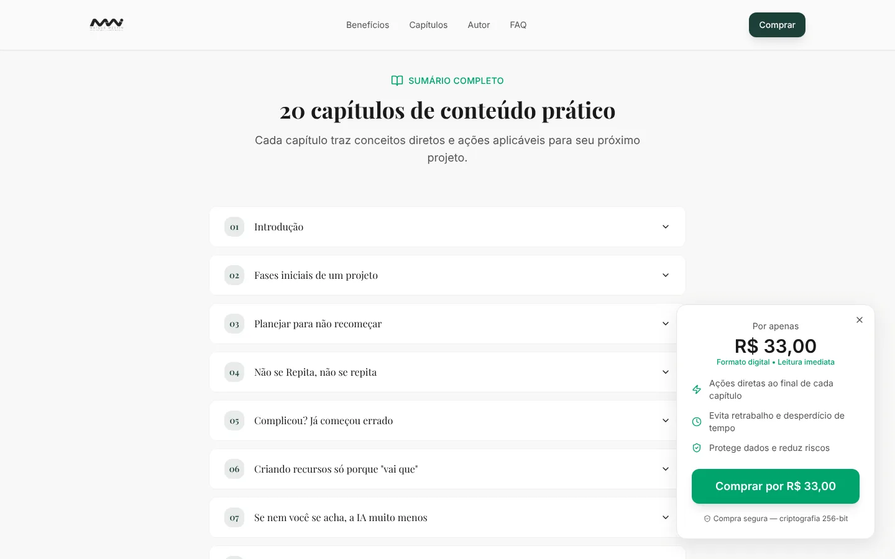

# Não existe botão mágico — Landing page do e-book

Página de vendas do e-book **_Não existe botão mágico_**, de Mateus Westin. O livro mostra o que os "gurus" não contam: a tecnologia de IA só funciona quando existe método e processo por trás. São **20 capítulos** de conteúdo prático, em PDF, por **R$ 33,00**, com a compra feita pela Kiwify.

🔗 **No ar:** [ebookvb.vercel.app](https://ebookvb.vercel.app)


## Como a página funciona

A página leva o visitante do problema até a compra, em seções:

1. **Hero:** capa do livro, promessa, preço e botão de compra.
2. **Benefícios:** metodologia clara e aplicável, menos retrabalho, proteção de dados, consistência em cada tela e vibe coding com responsabilidade.
3. **Capítulos:** sumário completo dos 20 capítulos em acordeão, com o resumo de cada um.
4. **Autor:** quem é Mateus Westin e por que escrever sobre o tema.
5. **Prova social**, **Entrega** (compra segura, e-mail de confirmação, download do PDF e acesso vitalício), **FAQ** e chamada final.

Uma **caixa de compra fixa** acompanha a rolagem (no canto da tela no desktop e como barra inferior no celular), e todos os botões levam para o checkout da Kiwify.

| Sumário com caixa de compra | Celular |
|---|---|
|  |  |

## Stack

- **React** + TypeScript, empacotado com **Vite**
- **Tailwind CSS** e componentes **shadcn/ui**
- Criado no [Lovable](https://lovable.dev/projects/eb76bac3-66de-4a3a-9a16-d19b782b75ce) e publicado na Vercel

## Rodando

```bash
npm install
npm run dev      # http://localhost:8080
npm run build    # gera dist/
```

As alterações feitas pelo Lovable são enviadas para este repositório automaticamente, e o que for enviado para cá também aparece lá.

## Onde está cada coisa

| Arquivo / pasta | Papel |
|---|---|
| `src/pages/Index.tsx` | Monta a página com todas as seções |
| `src/components/landing/` | Seções da página (Hero, Benefits, Chapters, Author, SocialProof, Delivery, FAQ, CTA, StickyPurchaseBox) |
| `src/components/ui/` | Componentes shadcn/ui |
| `src/assets/` | Capa do e-book, logo e fotos |
